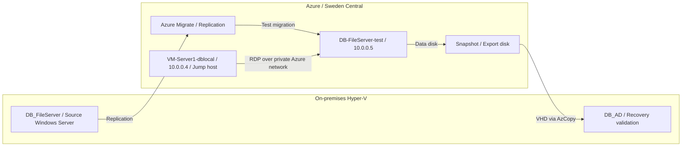
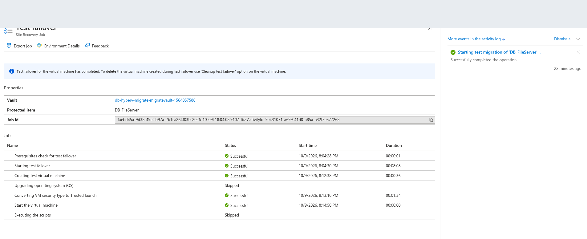
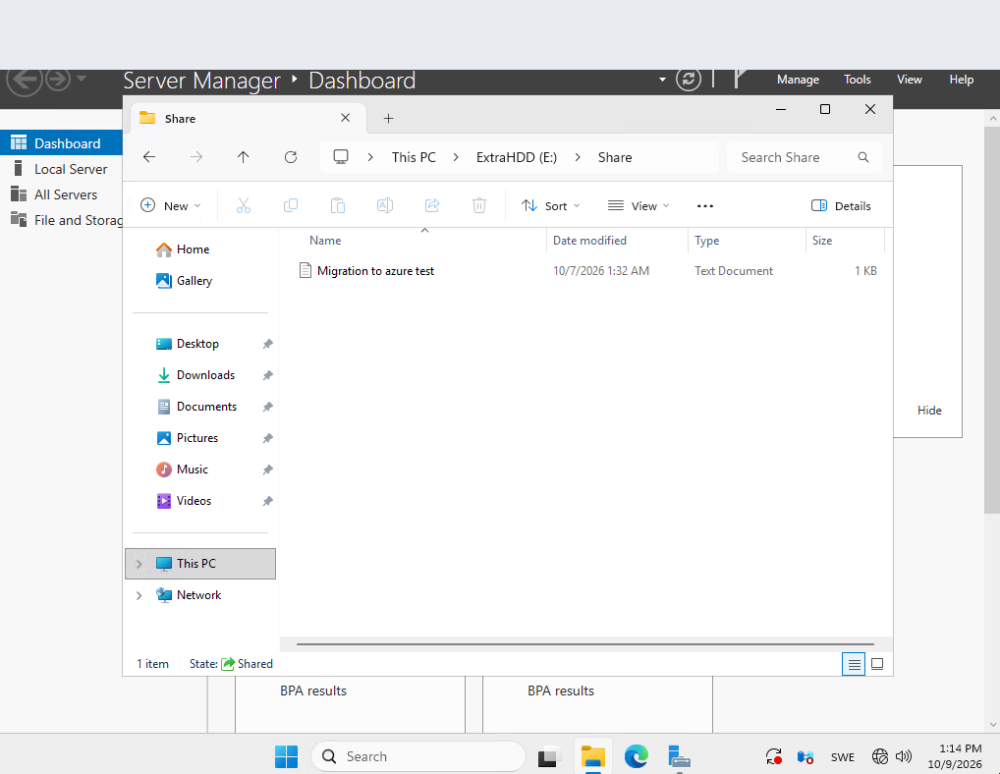
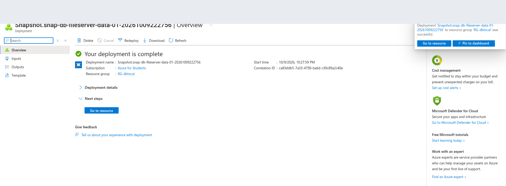
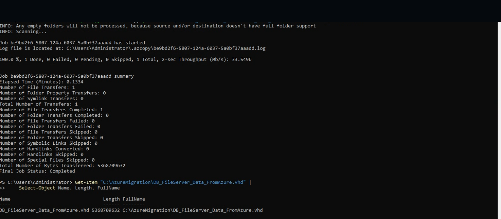
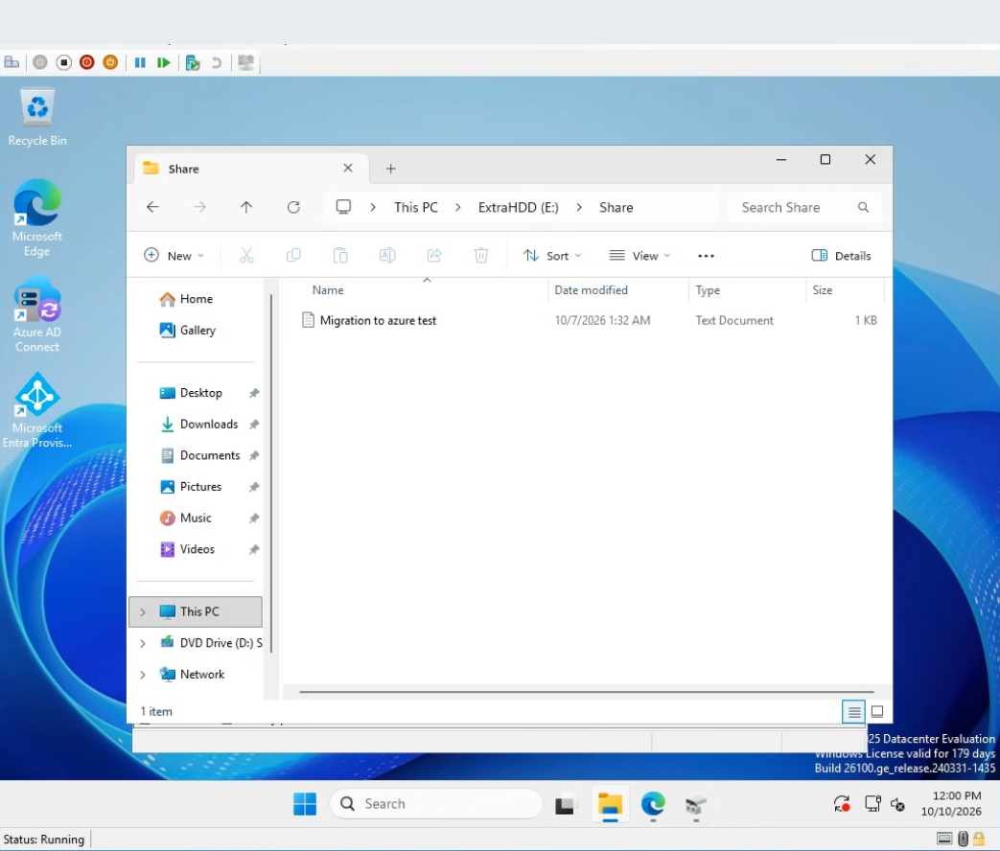

# Hyper-V to Azure Migration | Azure Infrastructure Labs

> **Status:** Completed lab. The Azure resources were subsequently **deleted to avoid ongoing cloud charges**. The evidence documents a successful **test migration**, not a production cutover.

## Overview

This hands-on lab documents the migration of an on-premises Hyper-V Windows Server file server into a Microsoft Azure **test** environment using Azure Migrate. I also validated Windows RDP connectivity via a private network, created a snapshot of the replicated data disk, exported it as a VHD with AzCopy, and reattached the downloaded disk to a local Hyper-V VM.

**Why it matters:** A migration is only useful if compute, networking and data recovery can all be validated. The lab also included several real troubleshooting steps rather than a perfect first-run deployment.

## Lab architecture

The jump host had a public IP when the lab was running. The **test VM did not have a public IP**; it was accessed through the jump host's Windows Remote Desktop client.

## Environment

| Item | Value |
| --- | --- |
| Source hypervisor | Hyper-V |
| Source file server | `DB_FileServer` |
| Local recovery VM | `DB_AD` |
| Azure migration | Azure Migrate |
| Resource group | `RG-dblocal` |
| Azure region | Sweden Central |
| Test VM | `DB-FileServer-test` (private IP `10.0.0.5`) |
| Azure jump host | `VM-Server1-dblocal` (private IP `10.0.0.4`) |
| Verification | `E:\Share` / `Migration to azure test` |

## Migration steps and evidence

### 1. Plan, register and configure replication

I created the migration project, installed and registered the Hyper-V provider, selected `DB_FileServer`, reviewed compute/disks and configured replication. Azure region-policy constraints, provider registration and storage-account settings required troubleshooting.

See [Migration procedure](docs/migration-guide.md) and [Troubleshooting](docs/troubleshooting.md).

### 2. Test migration to Azure

After reaching an eligible recovery point, I ran **Test migration** and confirmed the job completed successfully. This is **not evidence of production cutover**.

### 3. Inspect data and verify RDP access

The test VM used private IP `10.0.0.5`. I remotely accessed the Azure jump host, then opened Windows Remote Desktop inside it to connect to the test VM across the Azure internal network. The migrated file share was then checked.

**Evidence distinction:** The screenshot shows file-share contents; the two-hop RDP connection is documented from the performed steps, not independently proven by this single screenshot.

### 4. Snapshot, disk export and VHD download

I created a snapshot from the migrated data disk, created a managed disk from the snapshot and downloaded its VHD via AzCopy. The recorded transfer was approximately **5 GiB** (`5,368,709,632` bytes), with **one completed file and zero failed transfers**.

### 5. Recover VHD onto on-premises Hyper-V

I used **Hyper-V Manager → DB_AD → Settings → SCSI Controller → Hard Drive** to attach the VHD. Initially it was not visible in the file-selection dialog; using `*.*` as the file filter displayed it. I verified that the data was readable under `E:\Share` on `DB_AD`.

**Evidence distinction:** The last screenshot verifies the recovered data on `DB_AD`; it does not depict the Hyper-V attach dialog itself.

## Outcome

- **Succeeded:** Azure Migrate test migration and test VM creation.
- **Verified:** Data visibility and private-network RDP access through an Azure jump host.
- **Succeeded:** Snapshot/disk export and AzCopy VHD download.
- **Verified:** Exported VHD restored to on-premises `DB_AD`, test file readable.
- **Cost control:** Azure lab resources removed after completion.
- **Not claimed:** Production cutover, business continuity SLA, or a permanently running Azure deployment.

## Documentation

- [Step-by-step technical notes](docs/migration-guide.md)
- [Failures and lessons learned](docs/troubleshooting.md)
- [Security and cost considerations](docs/security.md)

## Evidence publication policy

Only a **small curated subset** of screenshots is included in this portfolio. Headers were covered in the provided publication copies and the SAS URL was removed from the AzCopy image. The original lab screenshots are kept outside Git. Screenshot files should still be reviewed visually before being pushed to a public repository. Never publish active storage SAS URLs, registration keys, passwords, access keys or credentials.
