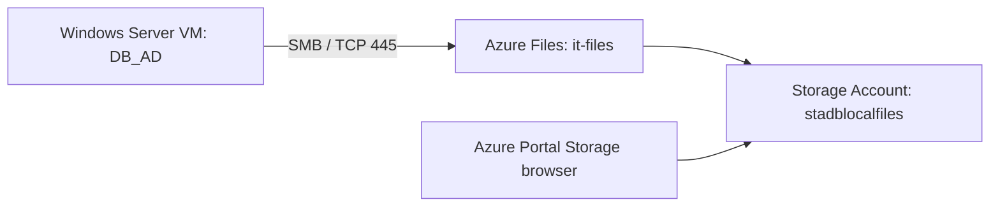
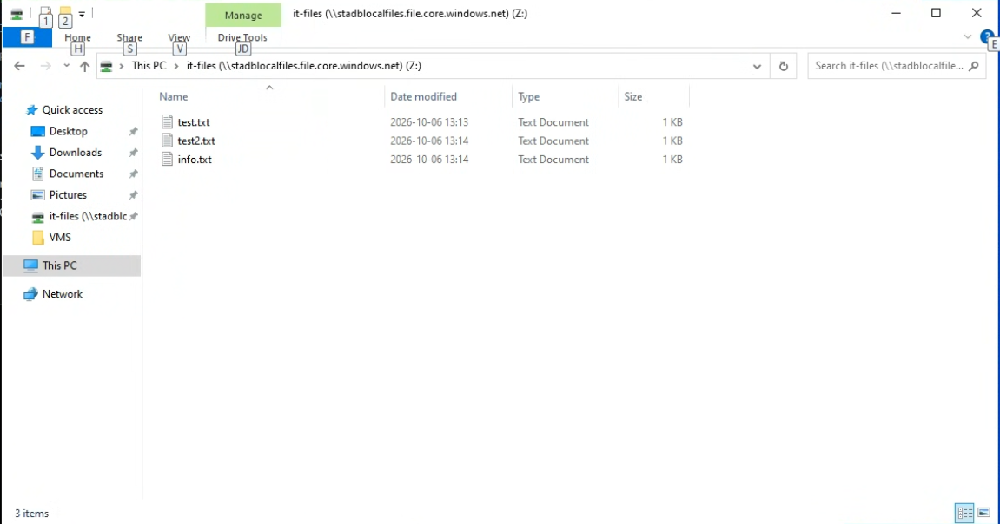
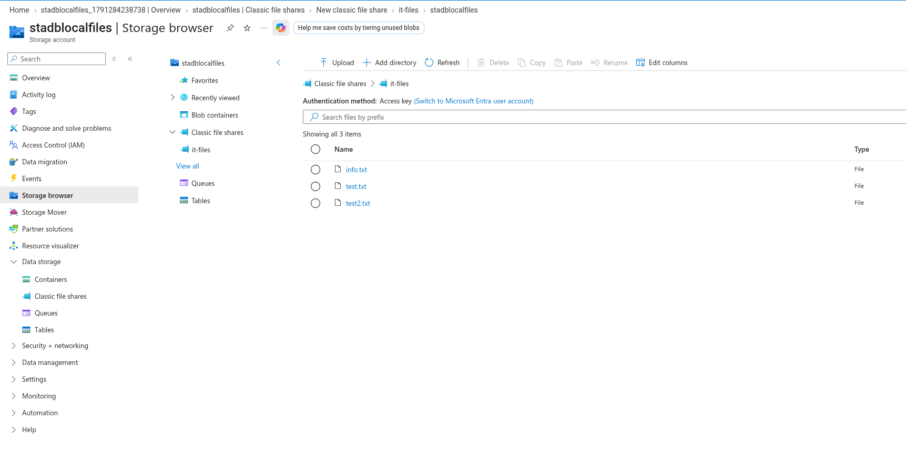

# Azure Files — Windows Server File Share Lab

> **Lab status:** Completed and documented from historical screenshots. The Azure resources were subsequently deleted; the environment is no longer running.

This project documents connecting a Windows Server VM to an **Azure Files SMB share** and validating that files were accessible both through Windows File Explorer and the Azure Portal Storage browser. It was completed as part of the Microsoft Azure cloud operations coursework at Nackademin.

## Objective

- Create and use an Azure Storage Account and Azure Files share.
- Connect from Windows Server over SMB, using a PowerShell-based workflow.
- Confirm that sample files are accessible both from the mounted drive and from the Azure Portal.
- Understand the security trade-offs of Storage Account access keys.

## Observed lab environment

| Component | Lab value / evidence |
| --- | --- |
| Storage account | `stadblocalfiles` |
| File share | `it-files` |
| SMB endpoint | `stadblocalfiles.file.core.windows.net` |
| Windows VM | `DB_AD` (Hyper-V VM connection shown in original screenshot) |
| Mapped drive | `Z:` |
| Example files | `info.txt`, `test.txt`, `test2.txt` |
| Connection test | PowerShell `Test-NetConnection` to SMB port `445` visible in original evidence |
| Azure browser authentication | Screenshot shows **Access key** |

The wider lab used the `RG-dblocal` resource group and Sweden Central region, but those settings are not independently visible in the two Azure Files screenshots. The screenshot of the PowerShell command is intentionally cropped to avoid publishing a possible account key or credential string.

## Architecture

*Conceptual view of the demonstrated connection. This diagram does not imply the storage account is currently deployed.*

## Evidence — screenshots from the lab

### 1. Mount the Azure Files share on Windows Server

The original screenshot shows a PowerShell session used for connectivity and share mapping, alongside File Explorer displaying the `Z:` drive and three text files. The published image is cropped to the file-explorer evidence only, because the original PowerShell window contains a credential-related command line.

### 2. Verify the files in Azure Portal

Azure Storage browser shows the `it-files` classic file share with the same three file names. The account identity in the portal header has been removed from the published image.

## What the screenshots establish

- A Windows Server session had a mapped drive pointing to the Azure Files endpoint.
- The three test files were visible through Windows File Explorer.
- The same file names were visible in the Azure Portal under the file share.
- The Azure Portal view indicates **Access key** authentication for the browser session.

**Evidence limits:** These screenshots alone do not prove which exact PowerShell script file was executed, that a specific firewall rule was changed, or that key rotation, encryption configuration, or least-privilege access had been implemented.

## Documentation

- [Setup and verification notes](docs/setup-guide.md)
- [Security considerations](docs/security.md)
- [Troubleshooting and evidence limits](docs/troubleshooting.md)

## Lessons learned

An Azure Files share can expose the same files through a Windows SMB mount and the Azure Portal, but successful connectivity depends on networking and authentication. Storage account keys are powerful credentials; publishing commands or screenshots without reviewing them can expose secrets. Azure lab resources were decommissioned after the exercises to avoid ongoing cost.
