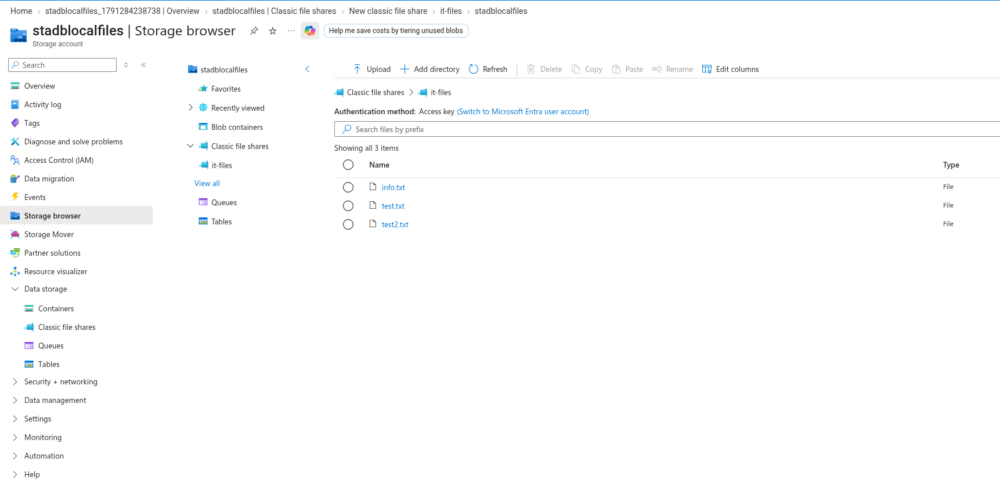
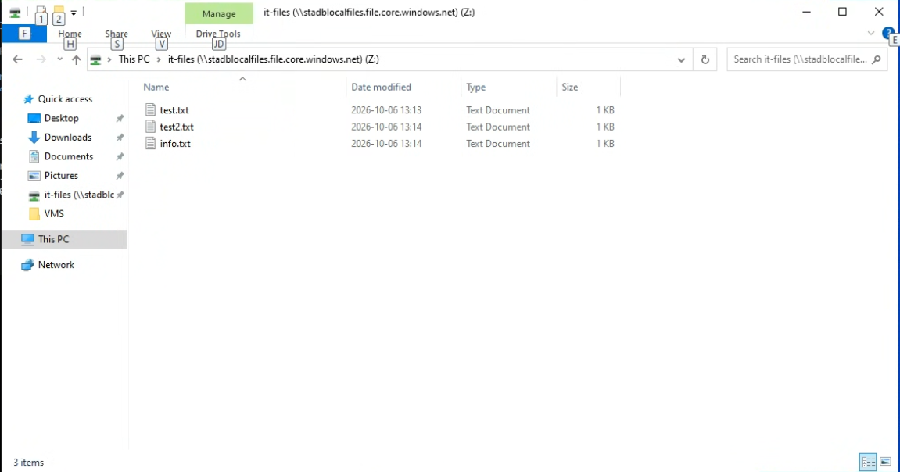

# Setup and verification notes

This document reconstructs the **verified workflow at a high level**, based on the historical screenshot evidence and the assignment context. It is not a transcript of every command actually executed.

## 1. Create a Storage Account and file share

In the lab, the storage account was called `stadblocalfiles`, with an Azure Files share called `it-files`. The Azure Portal Storage browser screenshot confirms that the share was present and contained sample text files.



## 2. Prepare SMB connectivity

The original Windows PowerShell screenshot shows a `Test-NetConnection` check against `stadblocalfiles.file.core.windows.net` using TCP port `445`. For SMB mounts, outbound access to that endpoint and port is required. The screenshot does not separately establish the result of every network setting in the environment.

**Illustrative command (not a verbatim record):**

```powershell
Test-NetConnection -ComputerName stadblocalfiles.file.core.windows.net -Port 445
```

## 3. Mount and inspect the file share

The Windows Server screenshot displays drive `Z:` mapped to `\\stadblocalfiles.file.core.windows.net\it-files`, and visible files `info.txt`, `test.txt`, and `test2.txt`.



## 4. Cross-check in Azure Portal

The Azure Storage browser screenshot lists the same three file names. This provides a second view of the data, independent of the Windows File Explorer view.

## 5. Tear down lab resources

The Azure resources were deleted after the lab was completed. There is no claim that the SMB endpoint or mapped drive remains accessible today.
