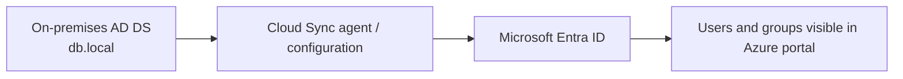
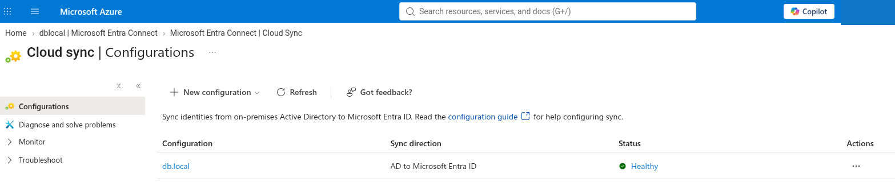
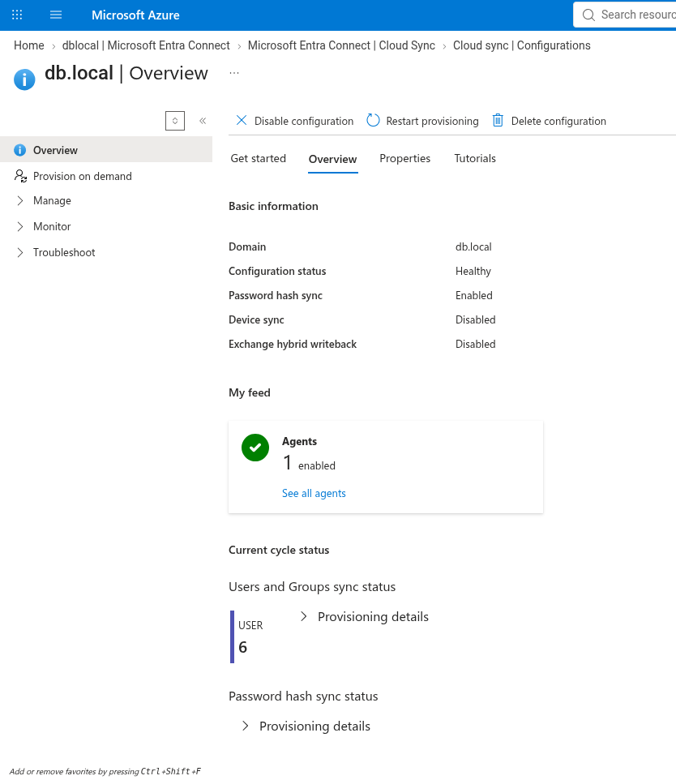
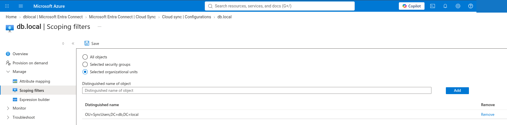
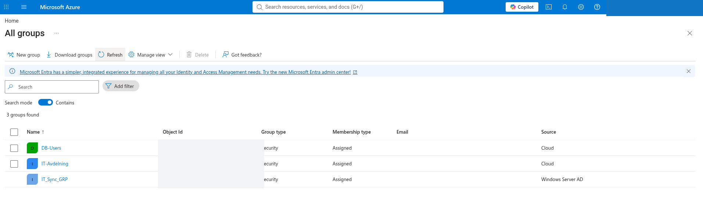
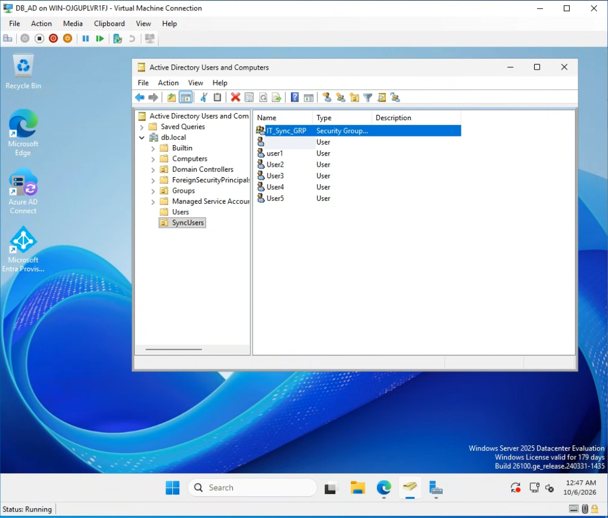
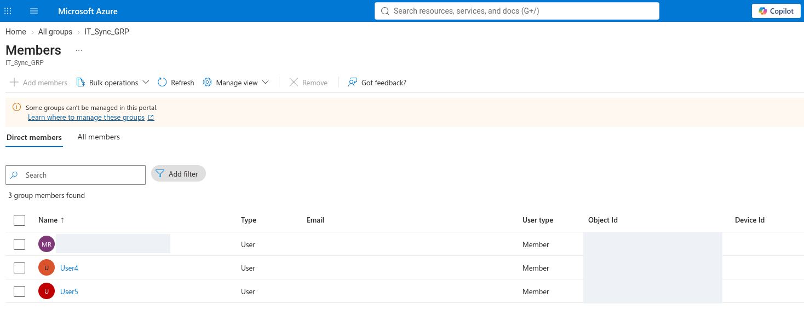

# Hybrid Identity Lab — Microsoft Entra Cloud Sync

> **Lab status:** Completed using a historical lab environment. The associated Azure resources have since been deleted. This is a documented educational lab, not a live service or a production deployment.

## Overview

This project documents **selective synchronization of on-premises Active Directory identities to Microsoft Entra ID** using **Microsoft Entra Cloud Sync**. The lab domain was `db.local` and the source directory was hosted on Windows Server/Hyper-V.

**Important product distinction:** The portal screenshots explicitly show **Microsoft Entra Connect → Cloud Sync** and a Cloud Sync configuration. This README uses that precise product name rather than assuming the traditional Entra Connect Sync engine was used.

## Objective

Understand the connection between an on-premises Active Directory environment and Microsoft Entra ID, scope which directory objects are synchronized, and validate the resulting cloud identities/groups.

## Evidence-based architecture

The screenshots show a configuration named `db.local`, **one enabled agent**, and a **Healthy** state. They do not prove production high availability or bidirectional synchronization.

## Walkthrough

### 1. Inspect the Cloud Sync configuration

The Azure portal lists the `db.local` Cloud Sync configuration as **Healthy**.

### 2. Confirm configuration status and settings

The configuration overview reports **Healthy**, **Password hash sync: Enabled**, **Device sync: Disabled**, and **Exchange hybrid writeback: Disabled**. The screenshot also shows **six users** in its provisioning summary.

### 3. Scope synchronization to an organizational unit

In **Scoping filters**, **Selected organizational units** is selected. The configured distinguished name is `OU=SyncUsers,DC=db,DC=local`. This demonstrates scoped synchronization rather than selecting every directory object.

### 4. Inspect cloud groups

The Entra portal shows groups including a group synced from Windows Server Active Directory. This supports checking group visibility but does **not by itself** prove all expected group memberships synchronized.

### 5. Compare the on-premises source

The local Active Directory Users and Computers view shows the `SyncUsers` OU and an IT-related security group in the lab directory.

### 6. Check membership in Entra ID

The Entra ID group membership screen shows three direct members in `IT_Sync_GRP`. Personal names and object IDs have been masked in this public documentation.

## Results and limitations

- A Cloud Sync configuration for `db.local` is visibly **Healthy**.
- Scoped filtering is configured for `OU=SyncUsers,DC=db,DC=local`.
- The portal shows an enabled agent and a six-user provisioning count.
- The cloud group membership view lists three direct members.
- The screenshots do **not** independently establish sync latency, the exact history of every user object, disaster recovery, or a successful post-change delta sync test.
- Azure lab resources were removed after the exercise to reduce ongoing costs.

## Detailed notes

- [Setup and validation](docs/setup-guide.md)
- [Troubleshooting and verification limits](docs/troubleshooting.md)
- [Security considerations](docs/security.md)

## Technologies

Active Directory Domain Services · Windows Server · Hyper-V · Microsoft Entra ID · Microsoft Entra Cloud Sync · Organizational Units · Security Groups · Password Hash Sync
