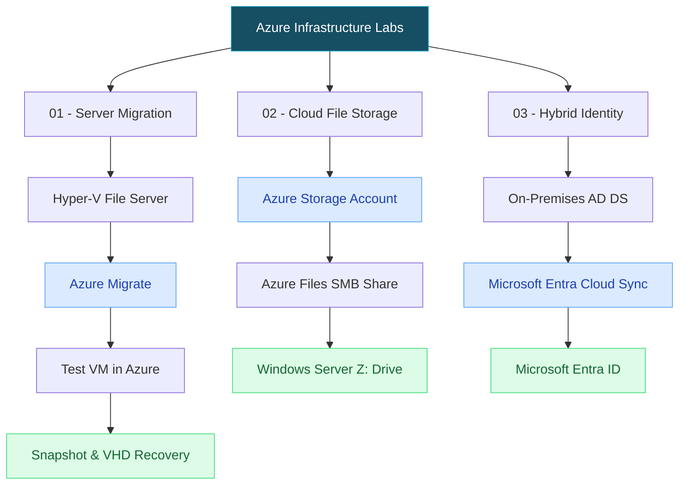
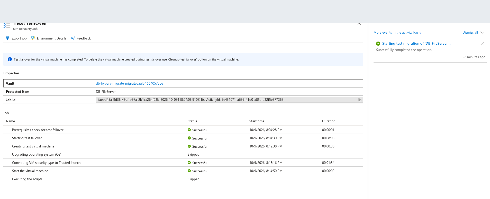
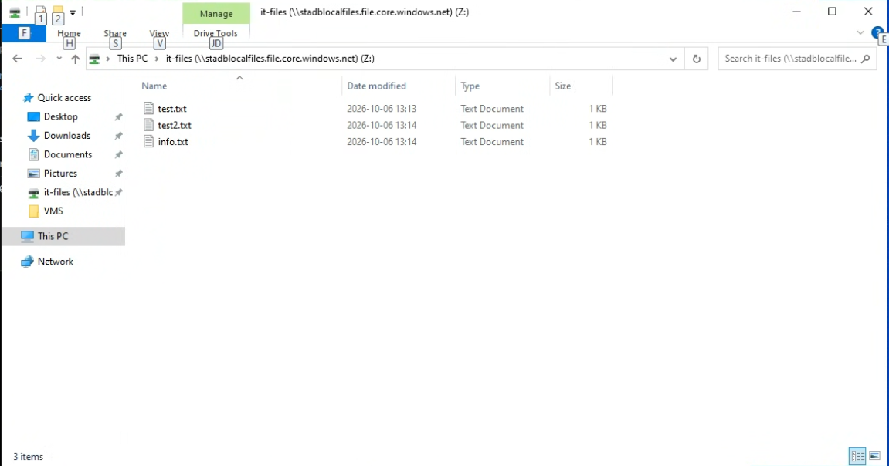
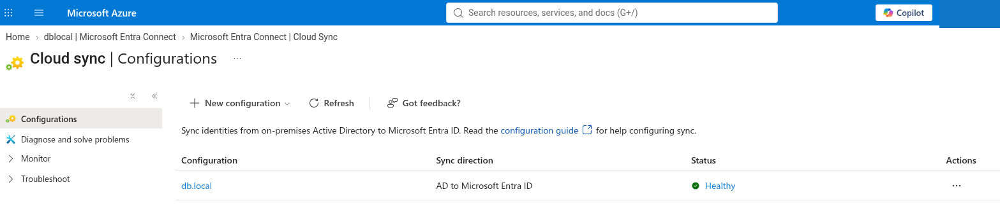
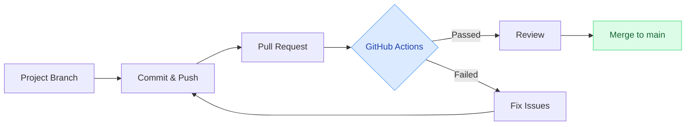

# Azure Infrastructure Labs

### Cloud Infrastructure · Hybrid Identity · Migration · DevOps

A collection of hands-on Microsoft Azure and hybrid infrastructure labs completed during my **DevOps Engineer studies at Nackademin, Sweden**.

This portfolio focuses on real implementation, technical troubleshooting, security considerations, and evidence-based documentation.

---

## Project Portfolio

| Project | Main technologies | Status |
|:---|:---|:---|
| [01 — Hyper-V to Azure Migration](01-hyperv-to-azure-migration/README.md) | Azure Migrate, Hyper-V, RDP, Snapshots, AzCopy | ✅ Completed |
| [02 — Azure Files & SMB](02-azure-files/README.md) | Azure Storage, Azure Files, SMB, PowerShell | ✅ Completed |
| [03 — Microsoft Entra Cloud Sync](03-entra-id-sync/README.md) | AD DS, Microsoft Entra ID, Cloud Sync, OU Scoping | ✅ Completed |
| 04 — Azure VM & Ansible | Linux, Azure VM, Ansible | 📋 Planned |

## Infrastructure Overview

The three completed projects demonstrate complementary parts of a hybrid Microsoft infrastructure.

*The diagram groups separate educational lab environments. It does not represent one continuously running production deployment.*

---

## 01 — Hyper-V to Azure Migration

**Goal:** Test the migration of an on-premises Windows Server file server to Microsoft Azure and recover its data disk back to Hyper-V.

**What I implemented:**

- Registered a Hyper-V host with Azure Migrate.
- Configured replication and resolved migration-related errors.
- Completed an Azure test migration.
- Verified remote access through an Azure jump VM using RDP.
- Created a disk snapshot and exported a VHD using AzCopy.
- Reattached the downloaded VHD to an on-premises VM and verified file access.

**Outcome:** Successful test migration and on-premises disk recovery. No production cutover is claimed.

[Read the full migration documentation](01-hyperv-to-azure-migration/README.md)

---

## 02 — Azure Files & SMB

**Goal:** Configure cloud file storage and access an Azure Files share from Windows Server.

**What I implemented:**

- Configured an Azure Storage Account and file share.
- Connected a Windows environment to Azure Files over SMB.
- Verified access through a mapped network drive.
- Examined security risks related to Storage Account Keys.

**Outcome:** Azure Files was accessible as a mapped network drive, and test files were visible in the cloud share.

[Read the Azure Files documentation](02-azure-files/README.md)

---

## 03 — Microsoft Entra Cloud Sync

**Goal:** Explore hybrid identity by synchronizing selected on-premises Active Directory objects to Microsoft Entra ID.

**What I implemented:**

- Used an on-premises Active Directory domain (`db.local`).
- Configured Microsoft Entra Cloud Sync.
- Scoped synchronization to the `SyncUsers` organizational unit.
- Verified Cloud Sync configuration health.
- Inspected synchronized directory groups and memberships.

**Outcome:** A healthy Cloud Sync configuration and selected cloud directory objects were verified through the portal.

[Read the hybrid identity documentation](03-entra-id-sync/README.md)

---

## DevOps Workflow

Each project is developed in its own Git branch and submitted to `main` through a Pull Request.

### Automated Validation

The lightweight GitHub Actions workflow checks:

- Repository structure and required documentation.
- Local Markdown references and linked files.
- Selected potentially sensitive patterns in tracked text files.

[View the GitHub Actions workflow](.github/workflows/validate.yml)

**Limitations:** Automated tests do not inspect secrets embedded in images, validate real Azure resources, or guarantee infrastructure security. Screenshots must be reviewed manually. Branch protection rules are not currently enforced.

---

## Technical Skills

| Area | Technologies and concepts |
|---|---|
| Cloud | Microsoft Azure, Virtual Machines, Storage |
| Virtualization | Hyper-V, VM Migration, Snapshots, VHD |
| Identity | Active Directory, Microsoft Entra ID, Cloud Sync |
| Networking | Private IP, RDP, SMB, Network Security |
| Administration | Windows Server, PowerShell, AzCopy |
| DevOps | Git, GitHub, Pull Requests, GitHub Actions |
| Security | Access Control, Credential Protection, Risk Assessment |
| Documentation | Markdown, Mermaid, Troubleshooting Guides |

## Documentation Principles

- Use real lab evidence and screenshots.
- Clearly distinguish verified results from assumptions.
- Document technical failures and how they were resolved.
- Never publish credentials, access tokens, or secret keys.
- Identify the limitations of test environments.

## Environment Status

The Azure resources used for the completed labs were deleted after the exercises to avoid ongoing costs.

These repositories document **historical educational labs**, not currently running Azure production services.

## About This Portfolio

This repository is part of my practical DevOps and infrastructure learning journey.

My objective is to develop hands-on skills in cloud platforms, system administration, troubleshooting, security, and infrastructure automation.

## License

No license has been selected. All rights reserved.
